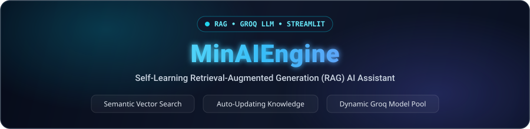
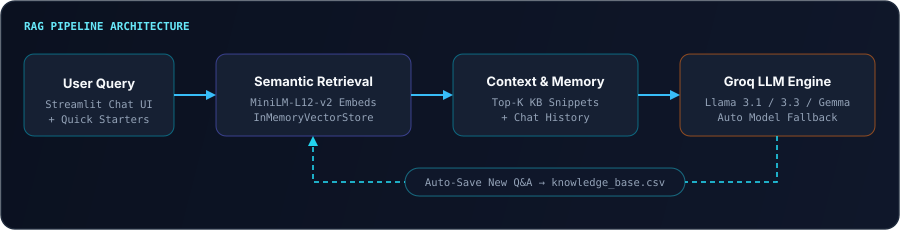

<p align="center">
  
</p>

<p align="center">
  <a href="https://www.python.org/"></a>
  <a href="https://streamlit.io/"></a>
  <a href="https://www.langchain.com/"></a>
  <a href="https://groq.com/"></a>
  <a href="./LICENSE"></a>
</p>

<p align="center">
  <strong>MinAIEngine</strong> is a Retrieval-Augmented Generation (RAG) AI assistant built with <strong>Python</strong>, <strong>LangChain</strong>, <strong>HuggingFace Multilingual Embeddings</strong>, <strong>Groq LLM</strong>, and a custom <strong>Glassmorphism Streamlit UI</strong> — featuring a self-learning CSV knowledge base.
</p>

---

## Key Features

| Feature | Description |
| :--- | :--- |
| **Multilingual Semantic Search** | Uses `sentence-transformers/paraphrase-multilingual-MiniLM-L12-v2` with `InMemoryVectorStore` to retrieve context by semantic meaning across Indonesian & English queries. |
| **Self-Learning Knowledge Base** | Automatically persists new Q&A pairs into `knowledge_base.csv` and indexes them live into the vector store (`simpan_ke_knowledge_base`). |
| **Dynamic Groq Model Pool** | Queries active models from the Groq API at runtime and prioritizes `llama-3.1-8b-instant`, `llama-3.3-70b-versatile`, `llama3-8b-8192`, `gemma2-9b-it`, and other available chat models. |
| **Conversational Memory** | Maintains recent chat history in the prompt template so follow-up questions stay context-aware. |
| **Glassmorphism Dark UI** | Custom CSS theme with ambient cyan/indigo gradients, compact hero transitions, and 4 quick-starter prompts for Data & AI topics. |

---

## Architecture

<p align="center">
  
</p>

---

## Tech Stack

- **Frontend:** [Streamlit](https://streamlit.io/) + Custom Glassmorphism CSS
- **Orchestration:** [LangChain](https://www.langchain.com/) (`langchain-core`, `langchain-groq`, `langchain-huggingface`)
- **Embeddings:** `sentence-transformers/paraphrase-multilingual-MiniLM-L12-v2`
- **Vector Store:** `InMemoryVectorStore`
- **LLM Inference:** [Groq API](https://console.groq.com/)
- **Data Storage:** `pandas` + `knowledge_base.csv`

---

## Quick Start

### 1. Clone the repository

```bash
git clone https://github.com/al-DataEngineer/AI_chatbotEngine.git
cd AI_chatbotEngine
```

### 2. Create a virtual environment & install dependencies

```bash
python -m venv .venv

# Windows
.venv\Scripts\activate

# macOS / Linux
source .venv/bin/activate

pip install -r requirements.txt
```

### 3. Configure your Groq API Key

Get a free API key from [Groq Console](https://console.groq.com/), then configure it using **either** method:

- **Option A — Environment Variable:**
  ```bash
  # Windows (PowerShell)
  $env:GROQ_API_KEY="gsk_your_api_key_here"

  # macOS / Linux
  export GROQ_API_KEY="gsk_your_api_key_here"
  ```
- **Option B — Streamlit Secrets:**
  Copy `.streamlit/secrets.toml.example` to `.streamlit/secrets.toml` and add your key:
  ```toml
  GROQ_API_KEY = "gsk_your_api_key_here"
  ```

### 4. Run the application

```bash
streamlit run app.py
```

---

## Project Structure

```text
AI_chatbotEngine/
├── .streamlit/
│   ├── config.toml               # Streamlit dark theme configuration
│   └── secrets.toml.example      # Example secrets template for GROQ_API_KEY
├── assets/
│   ├── banner.svg                # Repository hero banner
│   └── architecture.svg          # RAG pipeline diagram
├── app.py                        # Main Streamlit app, RAG pipeline & UI
├── knowledge_base.csv            # Verified Q&A knowledge base (auto-updated)
├── requirements.txt              # Python dependencies
├── LICENSE                       # MIT License
└── README.md                     # Project documentation
```

---

## License

This project is licensed under the **MIT License** — see the [LICENSE](./LICENSE) file for details.

<p align="center">
  Built by <a href="https://github.com/al-DataEngineer"><strong>Ahmad Alimin (@al-DataEngineer)</strong></a>
</p>
